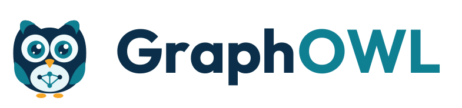
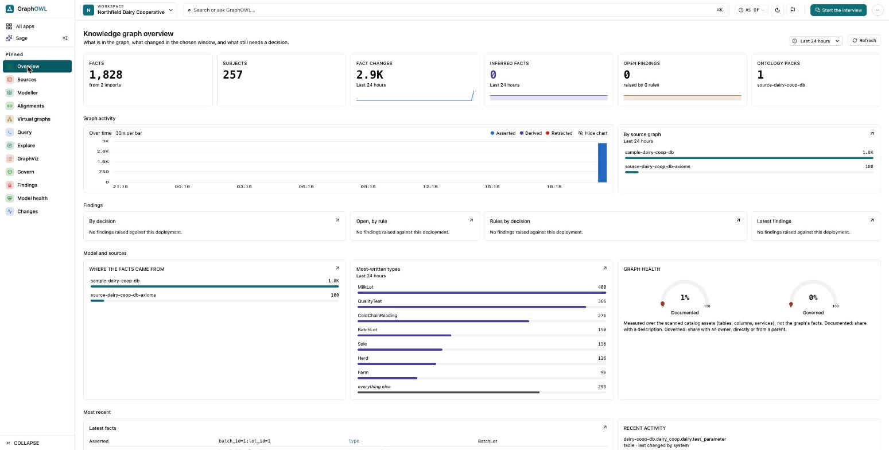
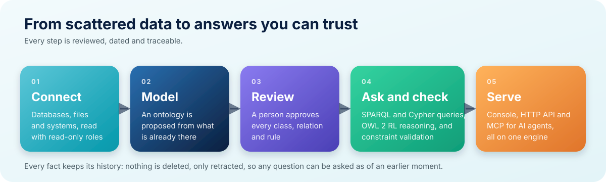
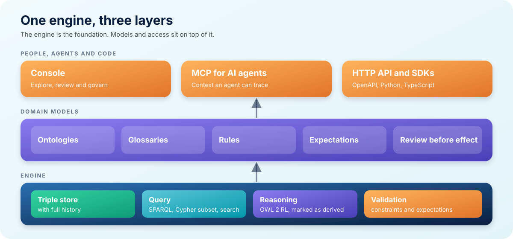

<p align="center">
  <picture>
    <source media="(prefers-color-scheme: dark)" srcset="assets/logo-lockup-dark.svg">
    
  </picture>
</p>

<h3 align="center">The knowledge graph engine.</h3>

<p align="center">
  Model, query, reason over and validate connected knowledge —<br>
  from your databases, documents and systems.
</p>

<p align="center">
  <a href="https://graphowl.app"></a>
  <a href="https://demo.graphowl.app"></a>
  <a href="api/openapi.json"></a>
  <a href="docs/standards.md"></a>
  
  
  
</p>

<p align="center">
  <a href="#what-it-does">What it does</a> ·
  <a href="#see-it">See it</a> ·
  <a href="#how-it-works">How it works</a> ·
  <a href="#try-the-api">Try the API</a> ·
  <a href="#standards">Standards</a> ·
  <a href="#whats-in-this-repository">This repository</a> ·
  <a href="#faq">FAQ</a>
</p>

<p align="center">
  
  <br>
  <sub>The console on a synthetic dairy cooperative: farms, milk lots, quality tests, batches and sales as one connected graph.</sub>
</p>

---

<p align="center">
  
</p>

## What it does

Most organisations know their data in pieces: a table here, a spreadsheet there, a rule in somebody's head. GraphOWL turns those pieces into **one graph that knows what things mean** — and then lets people and AI agents ask it questions, check it against rules and trust the answers.

| | |
|---|---|
| **Connect** | Read a source database through a read-only role, load files, or query a source in place as a virtual graph. Nothing in the console can change the source. |
| **Model** | Propose an ontology from what is already there. A person reviews every class, relation and rule before it takes effect — nothing is published unreviewed. |
| **Query** | SPARQL, a documented Cypher subset, graph traversal, keyword and semantic search — over the same facts. |
| **Reason** | OWL 2 RL reasoning derives what follows from the model, and marks it as derived, so inferred facts are never mistaken for stated ones. |
| **Validate** | SHACL-style constraints and quality expectations check the data against the model and report what does not fit. |
| **Remember** | Every fact keeps its history. Nothing is deleted, only retracted, so any question can be asked *as of* an earlier moment. |
| **Serve** | An HTTP API, an MCP server for AI agents, and a console for people — all on the same engine. |

It is **not** a metadata catalog with a graph bolted on, and it is not tied to one industry. A data catalog, a compliance model or a product domain is one *pack* of models and rules on the same engine.

## See it

The live demo runs on **Northfield Dairy Cooperative**, a synthetic organisation, so there is no real data in it. Its source database holds farms, milk lots, quality tests, production batches and retail sales.

1. **Scan** — GraphOWL reads the database's tables, columns and keys.
2. **Propose** — it proposes an ontology from them; a reviewer approves it.
3. **Load** — a bounded sample of rows becomes instances of the approved classes.
4. **Use** — explore the graph, ask questions in SPARQL or as graph patterns, and see how much of the model is covered and documented.

The demo is password-protected while GraphOWL is in early access. **To get a login, email <connect@graphowl.app>.**

## How it works

Three layers, one product; the engine is the foundation.

<p align="center">
  
</p>

- **Engine** — a triple store with time travel, constraint validation, reasoning and graph query.
- **Domain models** — ontologies, glossaries, rules and expectations, kept in the graph itself and reviewed before they take effect. Packs bundle them per domain, so the same engine serves a data catalog, a compliance model or a product domain.
- **Context layer** — ways for people and agents to use the graph: an MCP server, semantic search, the API and the console.

### Design commitments

- **Provenance over convenience.** Every fact says where it came from; inferred facts are marked as inferred.
- **Review before effect.** Models proposed by software are proposals until a person approves them.
- **Read-only toward your sources.** Source databases are read through read-only roles.
- **Standards first.** The data model and query languages are W3C standards, so your data is not locked in. What is and is not implemented is stated, dated, in [`docs/standards.md`](docs/standards.md).
- **Honest status.** This page says "early access" because it is early access.

## Use it from code

Client libraries (Apache-2.0, early access, not yet on PyPI or npm):

| Library | Repository |
|---|---|
| Python ingestion (`graphowl-ingest`), no runtime dependencies | [`graphowl/sdk-python`](https://github.com/graphowl/sdk-python) |
| TypeScript ingestion (`@graphowl/ingest`), types generated from the API description | [`graphowl/sdk-typescript`](https://github.com/graphowl/sdk-typescript) |
| Python client for reading, querying, reasoning and governance (`graphowl`) | [`graphowl/python-client`](https://github.com/graphowl/python-client) |

The ingestion libraries batch large pushes, attach an idempotency key so a retry never duplicates, and report a verdict per item. The Python client reads, queries, reasons and governs. Any OpenAPI generator can also turn the [HTTP API description](api/openapi.json) into a client for another language.

## For AI agents

GraphOWL speaks MCP, so an agent can look up what a term means, follow relationships, run a query, and record what it found, with every answer traceable to the facts and rules behind it. Context is only useful to an agent if it is *current*, *reviewed* and *attributable*; those three are properties of the engine, not of the prompt.

## What you can build

- **A data catalog** whose definitions, owners and lineage are queried like any other fact.
- **A domain model** for a business area, checked against the data that is supposed to follow it.
- **A compliance rule set** that reports which records break which rule, and why.
- **Context for AI assistants** that is reviewed, dated and traceable.
- **Answers across sources** without first copying everything into one place.

## Try the API

The full description is in [`api/openapi.json`](api/openapi.json) (see [`api/README.md`](api/README.md)). Requests are JSON, authenticated with a bearer token, and errors are [RFC 9457](https://www.rfc-editor.org/rfc/rfc9457) problem documents.

Ask a SPARQL question:

```bash
curl -X POST https://demo.graphowl.app/sparql \
  -H "Authorization: Bearer $TOKEN" \
  -H "Content-Type: application/json" \
  -d '{"query": "SELECT ?class (COUNT(?s) AS ?n) WHERE { GRAPH ?g { ?s a ?class } } GROUP BY ?class ORDER BY DESC(?n)"}'
```

Ask a question as it stood at an earlier moment (`asOf` is an RFC 3339 timestamp; leave it out for now). Imported facts live in named graphs, hence `GRAPH ?g`:

```bash
curl -X POST https://demo.graphowl.app/sparql \
  -H "Authorization: Bearer $TOKEN" \
  -H "Content-Type: application/json" \
  -d '{"query": "SELECT (COUNT(*) AS ?n) WHERE { GRAPH ?g { ?s ?p ?o } }", "asOf": "2026-10-12T15:50:00Z"}'
```

The same body shape works for Cypher at `POST /cypher`. Other routes you will reach for first:

| Route | What it does |
|---|---|
| `GET /workspaces` | The workspaces you can see; a workspace holds one team's sources, models and graph |
| `POST /sparql` · `POST /cypher` | Query the graph |
| `GET /search` · `GET /search/nodes/embedding` | Keyword and semantic search |
| `POST /reasoning/runs` | Run reasoning and see what was derived |
| `POST /mcp` | The MCP endpoint for AI agents |
| `GET /health` · `GET /ready` | Liveness and readiness |

The demo is password-protected, so these calls need a login first (see [See it](#see-it)).

## Built in Rust

The server is written in [Rust](https://www.rust-lang.org), as a workspace of small, single-purpose crates (storage, query, reasoning, validation, search, the HTTP layer and more) rather than one large program. That choice has concrete consequences for what you run:

| What Rust gives | What it means for you |
|---|---|
| **Memory safety without a garbage collector** | A whole class of crashes and security flaws (use-after-free, buffer overruns, data races) cannot be written in safe code, and there are no collector pauses to show up as latency spikes. |
| **Predictable resource use** | A graph engine holds a lot of data and answers many queries at once. Memory is released when it is no longer used, not when a collector gets round to it, so footprint stays steady under load. |
| **One self-contained server** | The server, the console it serves and the API ship as a single program. There is no runtime or virtual machine to install, and few moving parts to operate. |
| **Fearless concurrency** | The compiler rejects unsynchronised sharing between threads, so concurrent queries, reasoning runs and imports do not corrupt each other. |
| **Types that carry the design** | The rules the engine enforces (a fact has a source, a derived fact is marked derived, a model change needs review) are encoded in types, so breaking them is a compile error, not a runtime surprise. |
| **A short, audited supply chain** | Dependencies are checked on every build against a permissive-only licence allow-list, and the full list is published as a [software bill of materials](compliance/THIRD-PARTY-LICENSES.md). |

Storage is PostgreSQL. The engine uses it as a durable, operable home for facts and their history, and the API and console sit on top.

**What this section does not claim:** no benchmark figures. Speed claims need a published method and data, and those are on the [roadmap](#roadmap), not yet in this repository.

## Standards

GraphOWL is built on W3C standards for graph data: **RDF**, **SPARQL**, **SHACL**, **OWL 2 RL** and **SKOS**, plus a documented Cypher subset. It publishes a dated page saying precisely what it implements, what it does not, and when each statement was last checked: [`docs/standards.md`](docs/standards.md). Nothing there is a certified conformance claim.

## What's in this repository

This is the **public home** of GraphOWL: where releases are announced, where problems are reported and where questions are answered. **It does not contain the product's source code, which is proprietary.**

| What | Where | State |
|---|---|---|
| Release notes | [`CHANGELOG.md`](CHANGELOG.md) | Live |
| API specification (OpenAPI) | [`api/openapi.json`](api/openapi.json) | Live |
| Standards conformance, dated | [`docs/standards.md`](docs/standards.md) | Live |
| Bug reports and feature requests | [Issues](../../issues) | Live |
| Questions and discussion | [Discussions](../../discussions) | Live |
| How to report a vulnerability | [`SECURITY.md`](SECURITY.md) | Live |
| Further documentation | this repository | Planned |
| Client libraries | [`sdk-python`](https://github.com/graphowl/sdk-python), [`sdk-typescript`](https://github.com/graphowl/sdk-typescript), [`python-client`](https://github.com/graphowl/python-client) (Apache-2.0) | Live, early access |
| Early-access evaluation licence (draft, awaiting legal review) | [`legal/EVALUATION-LICENSE.md`](legal/EVALUATION-LICENSE.md) | Draft |
| Software bill of materials and third-party licences | [`compliance/`](compliance) | Live |
| Runnable examples and synthetic sample data | [`examples`](https://github.com/graphowl/examples) (Apache-2.0) | Live, early access |

"Planned" means exactly that: not published yet, and no date is promised.

## Roadmap

Early access means the surface is still moving. What is being worked on, in the order it is likely to land:

- [x] Engine: triple store with history, SPARQL, reasoning, validation
- [x] Console: workspaces, model review, graph exploration
- [x] Public API description and standards page
- [x] Client libraries: ingestion (Python, TypeScript) and a Python client for reading and governing
- [ ] Documentation site, product site and a quickstart that a stranger can follow
- [x] Runnable examples and synthetic sample data
- [ ] Sample packs and the pack format documented
- [x] Software bill of materials and licence report (regenerated for each release)
- [ ] Published benchmarks, with the method that produced them

No dates are promised. Watch [releases](../../releases) or the [changelog](CHANGELOG.md).

## FAQ

**Is GraphOWL open source?**
No. The product is proprietary. This repository, the API description and the client libraries and examples published separately are public; each states its licence.

**Is it only for metadata and data catalogs?**
No. A catalog is one use. The engine stores and reasons over any connected knowledge: a business domain, a compliance rule set, a product model.

**Where does my data live?**
In GraphOWL's own store. Source databases are read through read-only roles and are never written to.

**Can an AI agent use it?**
Yes. An MCP server exposes the graph to agents, and every answer can be traced to the facts and rules behind it.

**Can I get my data out?**
Yes. Facts export as Turtle, JSON-LD, N-Triples and N-Quads. See [`docs/standards.md`](docs/standards.md) for what is and is not supported.

**How do I try it?**
Email <connect@graphowl.app> for a demo login.

## Licence

The text in this repository is licensed under [Creative Commons Attribution 4.0](LICENSE). **The GraphOWL name and logos (in `assets/` and `brand/`) are not covered by that licence** — see [`brand/README.md`](brand/README.md). The GraphOWL product itself is proprietary and all rights are reserved. Libraries and examples published in other repositories carry their own licence, stated in each.

## Contact

<connect@graphowl.app> · [graphowl.app](https://graphowl.app)
